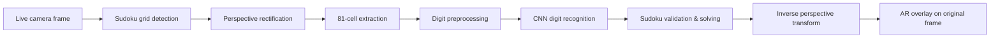
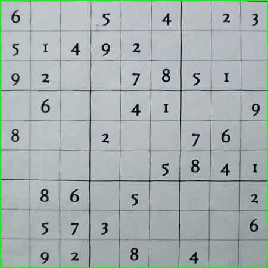
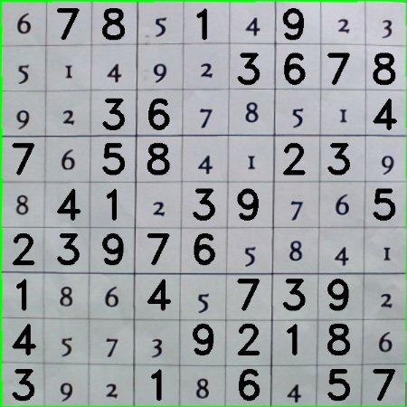
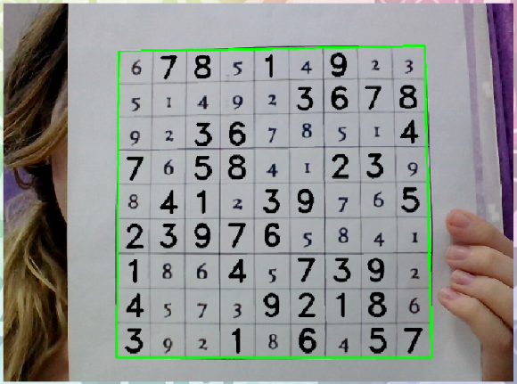
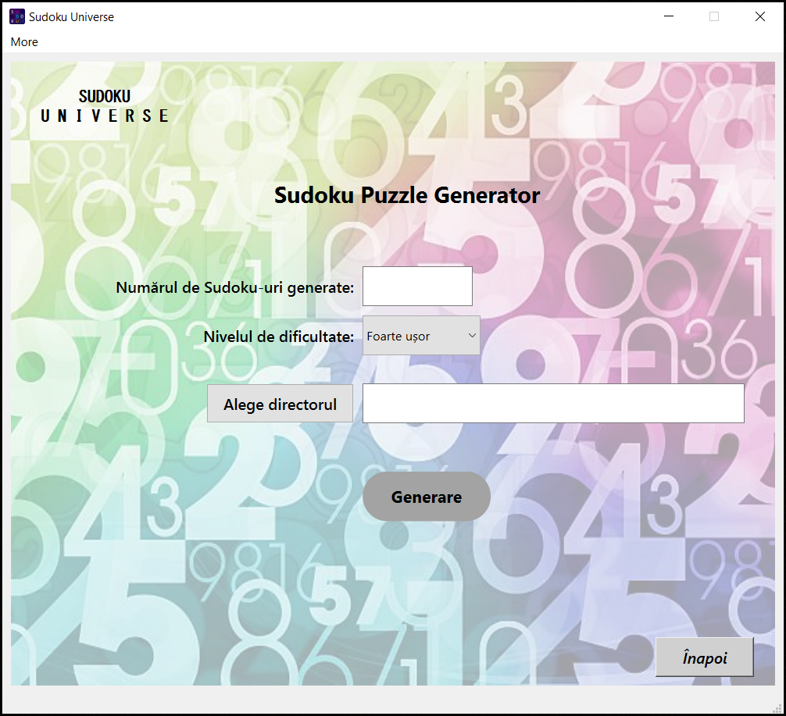
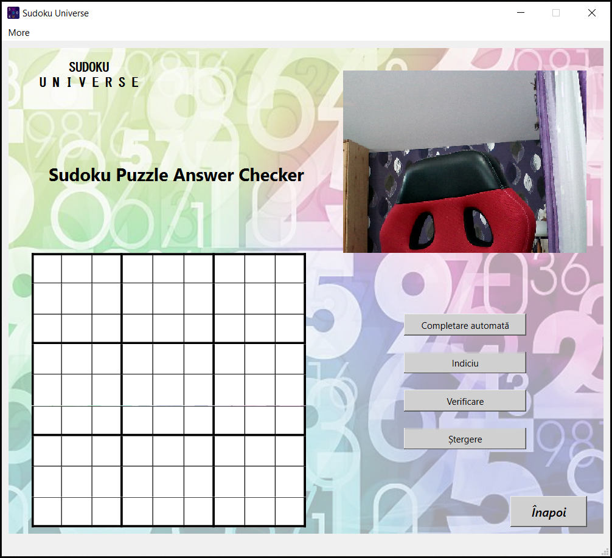

# Augmented Reality Sudoku Solver

> **Real-time Sudoku detection, digit recognition, solving, and augmented-reality projection using C++, OpenCV, Qt, and deep learning.**

  

  <em>From a live camera frame to a solved puzzle projected back onto the physical Sudoku.</em>

This project is a desktop computer-vision application that recognizes a printed Sudoku puzzle from a camera feed, reconstructs the grid, identifies the existing digits, solves the puzzle, and overlays only the missing values back onto the original scene.

Beyond the AR solver, the application also includes a **Sudoku generator with five difficulty levels**, **unique-solution validation**, **PDF export**, and an **interactive answer checker** with hints and automatic completion.

### Full technical write-up

The complete development story — including the image-processing pipeline, CNN workflow, implementation decisions, intermediate results, and many additional figures — is available on my original project website:

**[Read the full technical case study →](https://schwarz28iva.github.io/indrei-valentina/project_page_eng.html)**

> **Source code:** The full implementation is kept private. This public repository is a technical showcase of the system, its architecture, functionality, and results.

---

## What the system does

The main workflow combines classical computer vision with learned digit recognition:

1. Detect the Sudoku grid in the camera frame.
2. Rectify the grid into a normalized top-down view.
3. Split it into its 81 cells.
4. Detect and normalize cells containing printed digits.
5. Recognize the digits with a convolutional neural network.
6. Reconstruct and validate the Sudoku board.
7. Solve the puzzle.
8. Project only the missing digits back onto the original camera image.

---

## Engineering highlights

- **Real-time grid detection** using OpenCV image processing and contour analysis.
- **Perspective correction** for angled or non-frontal Sudoku boards.
- **Cell-level extraction and preprocessing** across all 81 grid positions.
- **Printed digit recognition with a CNN**, trained in Python using TensorFlow/Keras.
- **C++ model integration** through `frugally-deep`.
- **Sudoku solving and validation**, including unique-solution checks where required.
- **Augmented-reality projection** using the inverse perspective transform.
- **Runtime optimization:** once a valid board has been recognized and solved, the solution can be reused while the same puzzle remains visible instead of repeating the full recognition pipeline on every frame.
- **Five-level Sudoku generator** with configurable difficulty.
- **PDF generation** for created puzzles.
- **Interactive answer checker** with Auto-fill, Hint, Check, and Clear functionality.
- **Desktop GUI** built with Qt / Qt Designer.

---

## Tech stack

| Area | Technology |
| --- | --- |
| Main application | **C++** |
| Computer vision | **OpenCV** |
| Desktop interface | **Qt / Qt Designer** |
| CNN training | **Python, TensorFlow, Keras** |
| CNN inference in C++ | **frugally-deep** |
| Core techniques | Image processing, contour detection, perspective transforms, OCR-style digit recognition, backtracking |
| Domain | Computer Vision, Augmented Reality, Desktop Software |

---

## Computer vision pipeline

A detected Sudoku board is transformed into a normalized square before the individual cells are processed.

  

After recognition and solving, the generated values can be combined with the original puzzle representation.

  

### Why the pipeline is split into stages

The visual input can vary in perspective, scale, lighting, and background. Normalizing the Sudoku board before digit recognition makes the later classification stage operate on a much more consistent representation.

The project therefore uses classical computer-vision operations for **localization and geometric normalization**, while the CNN is focused on the narrower task of **printed digit classification**.

---

## Digit recognition

The digit-recognition component was trained separately in Python with TensorFlow/Keras and then integrated into the C++ application.

During development, I moved beyond a generic handwritten-digit setup and used printed-digit data that better matched the actual appearance of Sudoku puzzles. The trained network is used after cell extraction and preprocessing, while empty cells are filtered before classification.

This separation helped keep the recognition problem focused: OpenCV handles the structure of the board, while the CNN handles digit identity.

---

## Augmented-reality result

The solver does not simply display a completed Sudoku in a separate window. After solving the normalized puzzle, the missing values are transformed back into the coordinate system of the original camera frame.

  

Existing clues remain unchanged, while only the values corresponding to originally empty cells are rendered as the AR solution.

---

## Sudoku Puzzle Generator

The application also includes a puzzle generator that creates valid Sudoku boards and removes clues while preserving a unique solution.

It supports **five difficulty levels** and can export generated puzzles as PDF files.

  

---

## Sudoku Puzzle Answer Checker

A separate checker interface allows a Sudoku to be completed interactively.

Supported actions include:

- **Auto-fill**
- **Hint**
- **Check**
- **Clear**

  

---

## Performance-oriented design

Running grid detection, cell extraction, digit recognition, and solving from scratch for every camera frame would introduce unnecessary work.

The application therefore keeps the solved result available while the same puzzle remains detected. The expensive recognition and solving steps do not need to be repeated continuously, allowing the live AR visualization to remain more responsive.

---

## Project background

This project was originally developed as my **Bachelor's thesis in Computer Science**.

### A personal note

This application was built during the first half of **2022**, before today's generation of widely available AI coding assistants had become part of everyday software development.

Looking back, it is difficult to fully convey how challenging this project was for me at the time. I was determined to build the entire application around **C++**, even when I was repeatedly told that what I wanted to achieve was too ambitious or impractical for a Bachelor's project. At one point, even my professors described the idea as something close to a *UFO* - an unusually ambitious combination of technologies for the scope of the project.

Getting it to work required far more than implementing the final pipeline. I went through many failed prototypes, incompatible libraries, abandoned technical approaches, integration problems, model-conversion issues, and countless iterations before all the pieces finally worked together: computer vision, CNN-based digit recognition, C++ inference, Sudoku algorithms, augmented reality, PDF generation, and a Qt desktop interface.

Somehow, after a great deal of trial and error, I managed to make the complete system work.

This project remains one of the pieces of work I am most proud of. Today, many parts of the development process can be accelerated dramatically by modern AI-assisted tools, so the finished application may no longer look as unusual as it did in 2022. But for me, its value lies just as much in the process behind it - the persistence, experimentation, failed approaches, and engineering decisions required to build something that, at the time, I was not even sure could be made to work.

What began as a Sudoku-solving task became a larger end-to-end application combining:

**computer vision → deep learning → algorithms → augmented reality → desktop UI**

The project was also extensively documented during development. The original website contains the detailed step-by-step implementation journey, intermediate experiments, visual explanations, and additional execution examples.

**[Explore the full project website / development blog →](https://schwarz28iva.github.io/indrei-valentina/project_page_eng.html)**

---

## Repository scope

This repository intentionally contains **showcase material only**.

The application source code, trained model files, and private implementation repository are not publicly distributed. The GIF and screenshots shown here come from the original working application.

---

## Author

**Valentina Indrei**

